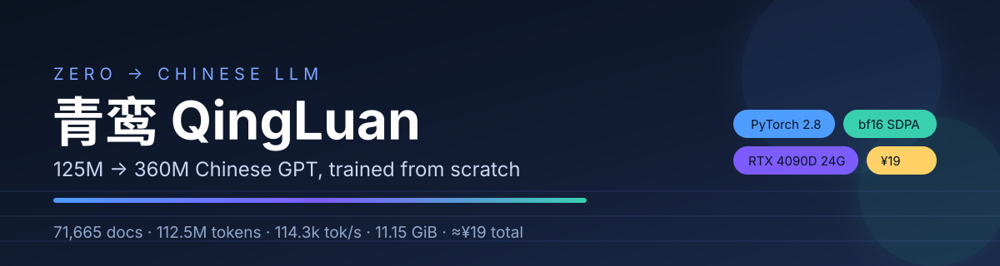
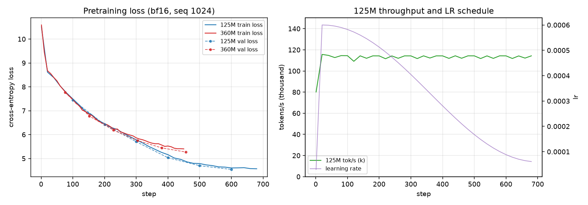
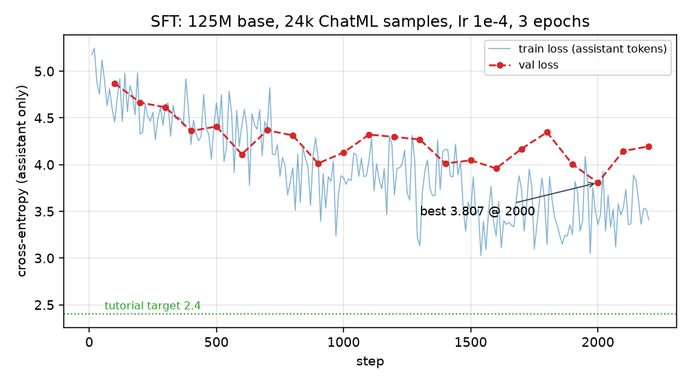

<div align="center">
  
</div>

<div align="center">

[](https://github.com/TanyaGaotiantian/zero-to-chinese-llm/stargazers)
[](LICENSE)
[](code/llm)
[](docs/02-pretraining.md)
[](docs/06-cost-and-pitfalls.md)

**从随机权重开始，用一张 24 GB 显卡、¥19 和 8 小时，完整走完「语料工程 → 125M 预训练 → 360M 预训练 → 断点续训硬验证 → SFT → 带日记记忆的对话 CLI」。**

**Every number below is measured, logged, and reproducible.** · [English](README_en.md)

</div>

---

## 📌 这是什么

一个**诚实的、端到端可复现**的中文大模型训练项目。不是又一个“调 API 的教程”，也不是“百亿参数复现”——它把**从零训练一个中文 LLM 真正会踩的每一步**摊开写清楚：

| | 规模 | 说明 |
|---|---|---|
| 语料 | **71,665 篇 / 112.50M tokens** | 中文维基百科 + 维基新闻 + 维基导游，自建清洗/去重/分词/打包流水线 |
| 模型 | **125.75M → 360.40M** | LLaMA 式结构（RMSNorm + RoPE + SwiGLU + tied embedding + SDPA），从随机权重训练 |
| 算力 | **RTX 4090D 24 GB** | 125M 跑 **114.3k tok/s**、峰值显存 **11.15 GiB**；360M 跑 33.3k tok/s |
| 钱 | **≈¥19** | 其中 ¥11.3 是一次事故浪费（详见 [踩坑](docs/06-cost-and-pitfalls.md)），有效训练成本 ≈¥7.6 |

### 三个最能说明“这不是玩具”的证据

1. **`kill -9` 续训验证通过**：训练跑到一半被 SIGKILL，从 `latest.pt` 续训后，与不间断基线逐 step 比对——**60/60 个 step 的 batch 指纹完全一致**，loss 最大偏差 **0.0100**（容差 0.05）。这证明数据顺序、优化器状态、RNG 状态被精确恢复，不是“能跑起来就算”。
2. **吞吐/显存可对齐**：125M/seq1024/bf16 在 4090D 上是 114.3k tok/s、11.15 GiB；同配置换一张卡就能验算，`results/` 里留着原始 `train.csv`。
3. **语料漏斗逐层可查**：485,894 篇原始文档 → 283,923 篇过质量闸（58.4%）→ 去重 283,492 → 180M 字符预算采样 71,665 篇，每一层的丢弃原因都记在 `results/funnel.json`。

> ⚠️ **它不能干什么**：125M 模型不会“很聪明”。它的价值是把**训练链路、续训语义、显存/吞吐边界、SFT 与记忆系统**全部跑通并可复现，而不是刷榜。

---

## 📊 结果一览

### 语料（任务 02）

| 划分 | 文档数 | 字符数 | tokens |
|---|---:|---:|---:|
| train | 70,233 | 176,394,668 | **112,503,579** |
| val | 716 | 1,878,482 | 1,199,254 |
| test | 716 | 1,734,151 | 1,103,986 |
| **合计** | **71,665** | 180,007,301 | **114,806,819** |

分词器：sentencepiece **BPE 32,000**，`byte_fallback=true`，字符覆盖率 0.9995，实测 **1.568 字符/token**（中文正常区间 1.5–1.7）。
打包：`uint16` 连续流 + 文档间 EOS，`train.bin` 225 MB，可直接 `np.memmap` 零拷贝读取。

### 预训练（任务 01）

| 指标 | 125M | 360M |
|---|---:|---:|
| 参数量 | 125,753,088 | 360,403,968 |
| 层数 / d_model / heads | 14 / 768 / 12 | 26 / 1024 / 16 |
| 有效 batch | 491,520 tokens/step | 491,520 tokens/step |
| 步数 / tokens | 699 / 343.6M（3.05 epoch） | 456 / 224.1M（2 epoch） |
| 吞吐 | **114.3k tok/s** | 33.3k tok/s |
| 峰值显存（allocated / reserved） | **11.15 / 12.12 GiB** | 9.3 GiB（grad ckpt） |
| 终值 val_loss（ppl） | **4.541（93.8）** | 5.4 左右（见日志） |
| 墙钟 | 50.6 min | ~2.0 h |



### SFT + 记忆原型（任务 03）

> 关于 val_loss 与 2.4 的差距：base 只吃了 112.5M tokens（≈1.9 token/参数，计算最优约 20），
> SFT 只能对齐输出格式、补不回预训练欠下的能力。完整分析见 [docs/04-sft.md](docs/04-sft.md#5-结果)。

| 项 | 值 |
|---|---|
| 数据 | `YeungNLP/firefly-train-1.1M` 流式采样，过滤后 **24,000** 条（23,500 train / 500 val） |
| 模板 | ChatML，`<|im_start|>`=32000 / `<|im_end|>`=32001 追加在 32k 词表之上 |
| Loss | **只对 assistant 段计算**（user/system 的 label 全为 -100） |
| 结果 | val_loss **3.81**（最好，step 2000）/ 4.20（末）；3 epoch、2205 步 |
| 踩过的坑 | 忘记对 label 做 shift → 学到"复制输入"，val_loss 假性降到 **0.0005**，已修复并留档 |
| 记忆 | SQLite 单文件 + FTS5 trigram 索引；日记式摘要 + `covered_until` 防重复压缩；good/bad 反馈记到具体消息 |

---

## ⚡ 5 分钟快速开始（不需要 GPU）

跑通“模型定义 → 20 步训练 → 断点续训比对”的最小闭环，CPU 就够：

```bash
git clone https://github.com/TanyaGaotiantian/zero-to-chinese-llm && cd zero-to-chinese-llm
pip install torch numpy sentencepiece

# 1) 参数量对不对（期望 125.75M / 360.40M）
python code/llm/model.py

# 2) 造 40 万 token 的假数据，20 步冒烟（CPU 上约 1 分钟）
python code/llm/smoke_test.py --config smoke --steps 20

# 3) 断点续训一致性（同一配置跑两遍，一遍中途 SIGKILL）
python code/llm/smoke_test.py --resume-check
```

> 输出里 `loss ≈ ln(32000) = 10.37` 说明初始化正确；`batch fingerprints identical` 说明续训语义正确。

---

## 🚀 完整复现（约 8 小时 / ¥19）

### 0. 准备一台卡

| 项 | 建议 |
|---|---|
| 平台 | AutoDL（或任何按量 GPU 云），**4090 / 4090D 24 GB 性价比最高** |
| 镜像 | PyTorch **2.8.0** / Python **3.12** / CUDA **12.8** |
| 磁盘 | 系统盘 30 GB + 数据盘 50 GB（**数据一律放 `/root/autodl-tmp`**） |
| 计费 | 按量 ¥1.88/时；**关机即停 GPU 费用**，数据盘保留 |

### 1. 取数（30 分钟，可在“无卡模式”做）

```bash
bash scripts/fetch_sources.sh
```

它做了三件事：
- 中文维基百科：从 HF 镜像拉 `wikimedia/wikipedia` 的 `20231101.zh` parquet（**这是官方 dump 的同一衍生物**），实测 5.7 MB/s；
- 中文维基新闻 / 维基导游：官方 dump（34 MB / 14 MB）+ `wikiextractor`；
- 全部落成同一个 JSONL schema（`id/url/title/text`），后续处理**零分支**。

> 为什么不直接拉 `zhwiki-latest-pages-articles.xml.bz2`（3.45 GB）？实测 IDC 到维基的单连接被限速到 **9–80 KB/s**，全量要 12 小时以上；并行 range 也只能到 ~124 KB/s。见 [踩坑 #1](docs/06-cost-and-pitfalls.md)。

### 2. 语料工程（8 分钟）

```bash
bash scripts/prep2.sh
```

流水线：`parquet→jsonl` → `wikiextractor` → 清洗 → 精确+MinHash 去重 → 180M 字符预算采样 → 98/1/1 划分 → BPE 32k → `uint16` 打包 → 统计。
每一步都幂等（输出存在就跳过），所以**中断了直接重跑**。

### 3. 冒烟 + 续训验证（5 分钟）

```bash
bash scripts/stages.sh smoke     # 20 步，确认吞吐/显存
bash scripts/stages.sh resume    # kill -9 续训一致性比对
```

### 4. 预训练（125M: 50 min，360M: 2 h）

```bash
bash scripts/stages.sh 125m
bash scripts/stages.sh 360m
```

两阶段共用同一份数据；360M 打开 gradient checkpointing + `torch.compile`，显存压到 9 GB 出头。

### 5. SFT（40 分钟）

```bash
bash scripts/stages.sh sft
```

### 6. 带记忆的对话 CLI

```bash
bash scripts/demo_memory.sh
# 等价于：
export LLM_BASE_URL=http://127.0.0.1:8010/v1 LLM_MODEL=local-sft
python code/llm/serve_model.py --ckpt runs/sft/latest.pt \
       --tokenizer data/processed/tokenizer/zh_bpe.model --port 8010 &
python code/llm/memory_chat.py --session demo
```

CLI 里可用：`/diary`（把历史压成日记）、`/recall 关键词`（FTS5 检索）、`/feedback good|bad 备注`。

---

## 📖 教程目录

> 每章都能单独读，但建议按顺序：先有语料，才有模型；先验证续训，才敢长跑。

| 章 | 你会得到什么 | 关键数字 | 状态 |
|---|---|---|---|
| [00 · 全景](docs/00-overview.md) | 全链路图、阶段顺序的理由、验收表、时间表 | 4.5 h 纯计算 | ✅ |
| [01 · 语料工程](docs/01-corpus.md) | 抽取/清洗/去重/采样/分词/打包七步，含漏斗统计 | 485,894 → **71,665** 篇 | ✅ |
| [02 · 预训练](docs/02-pretraining.md) | LLaMA 式结构、超参依据、吞吐/显存分析 | **114.3k tok/s / 11.15 GiB** | ✅ |
| [03 · 断点续训](docs/03-resume.md) | `kill -9` 验证协议、ckpt 该存什么、五个常见错误 | **60/60 指纹一致** | ✅ |
| [04 · SFT](docs/04-sft.md) | ChatML、词表扩展、assistant-only loss、一个真实 bug | val **3.807**（best） | ✅ |
| [05 · 记忆原型](docs/05-memory.md) | SQLite + FTS5 日记记忆、抽取式兜底、质量闸 | 16 msg → 1 diary | ✅ |
| [06 · 成本与踩坑](docs/06-cost-and-pitfalls.md) | 逐项账单 + **8 个真实坑**（含 ¥11.3 的空转事故） | ≈¥19 | ✅ |
| [07 · 复现清单](docs/07-checklist.md) | 8 个阶段的勾选清单 + 期望输出 | — | ✅ |

英文版在 [docs/en/](docs/en/)。



---

## 🗂 项目结构

```text
zero-to-chinese-llm/
├─ README.md / README_en.md         # 中英双语入口
├─ docs/                            # 中文教程（8 章）
│  ├─ 00-overview.md                #   路线图与取舍
│  ├─ 01-corpus.md                  #   语料工程：漏斗、去重、分词、打包
│  ├─ 02-pretraining.md             #   模型结构、吞吐/显存、compile
│  ├─ 03-resume.md                  #   断点续训的硬验证方法论
│  ├─ 04-sft.md                     #   ChatML、assistant-only loss
│  ├─ 05-memory.md                  #   日记记忆 + FTS5 检索
│  ├─ 06-cost-and-pitfalls.md       #   成本明细 + 6 个真实坑
│  └─ 07-checklist.md               #   复现检查清单
├─ docs/en/                         # 英文版（同结构）
├─ code/llm/                        # 10 个可独立运行的脚本（无私有依赖）
├─ scripts/                         # 一键脚本（取数/语料/训练/演示）
├─ results/                         # 真实 train.csv / stats.json / 生成样例
└─ assets/                          # 图
```

| 文件 | 作用 | 依赖 |
|---|---|---|
| `model.py` | 125M/360M GPT（RMSNorm+RoPE+SwiGLU+SDPA，tied emb） | torch |
| `train.py` | 预训练 + **精确续训**（数据顺序/RNG/优化器全存） | torch, numpy |
| `parquet_to_jsonl.py` | HF parquet → wikiextractor 同构 JSONL | pyarrow |
| `prepare_corpus.py` | 清洗/去重/划分/分词/打包/统计（7 个子命令） | datasketch, sentencepiece |
| `sft.py` | ChatML SFT，assistant-only loss，特殊 token 扩展词表 | torch, sentencepiece |
| `build_sft_data.py` | 从 HF 流式构造 24k SFT 集（可用 `--source` 换源） | datasets |
| `memory_chat.py` | CLI 对话 + 日记压缩 + FTS5 检索 + 反馈 | 标准库 |
| `serve_model.py` | 把本地 ckpt 变成 OpenAI 兼容接口（无需 vLLM） | torch |
| `verify_resume.py` | 比对两份 `train.csv`，验证续训 | 标准库 |
| `smoke_test.py` | 5 分钟 CPU 冒烟（模型+训练+续训） | torch |

---

## 🧠 关键设计（为什么这么写）

<details>
<summary><b>1. 续训为什么要存“数据顺序 + RNG”</b></summary>

常规做法只存 `model/optimizer/step`，恢复后 dataloader 从头开始、学习率按新 step 算——**loss 曲线会断**。
本项目把 `epoch + pos + order 的 sha1` 一起存进 ckpt，恢复时用 `(seed, epoch)` 重建同一置换并校验 sha1；同时保存 `torch_rng` / `cuda_rng` 状态。这就是 §3 里 60/60 batch 指纹能对上的原因。
</details>

<details>
<summary><b>2. 为什么用 SDPA 而不是 FlashAttention</b></summary>

`F.scaled_dot_product_attention` 在 PyTorch 2.8 上会走 cuDNN/Flash 后端，**不用编译自定义 kernel**，换卡（4090 / 5090 / sm_120）不用重装。125M 这种小模型本来就不是 attention 瓶颈，装 FA 的收益抵不上环境成本。
</details>

<details>
<summary><b>3. 为什么 min-hash 要限制 shingle 数</b></summary>

28 万篇文档、每篇上千字符 → 3 亿个 5-gram，Python 里逐条 `update` 要 1 小时以上。改成**每篇确定性抽样 512 个 shingle + `update_batch`** 后，去重整段降到 2 分钟，且对“近似重复”的判定几乎无损（MinHash 本来就是抽样估计）。
</details>

<details>
<summary><b>4. SFT 为什么只对 assistant 段算 loss</b></summary>

如果 user/system 段也参与 loss，模型会花容量去“复述问题”，val_loss 虚低但生成能力不变。本项目的 `<|im_start|>role\n` 前缀、特殊 token、padding 全部 `label=-100`，只有 assistant 内容与结尾 `<|im_end|>` 参与梯度。
</details>

<details>
<summary><b>5. 记忆为什么用 FTS5 trigram 而不是向量库</b></summary>

日记条目数量小（几十到几千条），**中文子串检索**用 `tokenize='trigram'` 的 FTS5 就够，零额外依赖、零 embedding 成本、结果可解释。需要语义检索时再换向量库，接口不用动。
</details>

---

## 🕳 六个真实的坑（都花了钱）

| # | 坑 | 代价 | 解法 |
|---|---|---|---|
| 1 | 维基官方 dump 在 IDC 里被限速到 9–80 KB/s | 差点浪费 12 h | 换 HF parquet 通道（5.7 MB/s），同 schema 转换 |
| 2 | “无卡模式”只有 **0.5 核 / 2 GB** | 差点以为能做数据工程 | 无卡只用来下载，抽取/分词必须上 GPU 机 |
| 3 | 关机后 GPU 被别人抢走，`开机` 提示“空闲GPU不足” | 20 min | 用「克隆实例」换机（记得勾选数据盘！） |
| 4 | 克隆时没勾数据盘 | 重下 1.5 GB | 克隆面板第二个复选框必须点 |
| 5 | 工具调用被中断后没确认后台状态 | **实例空转 6 h = ¥11.3** | 每次都 `pgrep`/`tail` 确认；用自动接力的 `chain.sh` |
| 6 | `wikiextractor 3.1` 输出文件名从 `wiki_00` 变成 `AA` | 清洗读到 0 篇 | 不按文件名 glob，按目录下所有文件读 |

完整复盘见 [docs/06-cost-and-pitfalls.md](docs/06-cost-and-pitfalls.md)。

---

## 💰 成本明细

| 阶段 | 时长 | 金额 |
|---|---|---|
| 取数 + 语料工程（含无卡下载 1.2 h） | ~1.4 h | ¥0.37 |
| 冒烟 + 续训验证 | 5 min | ¥0.16 |
| 125M 预训练 | 50.6 min | ¥1.59 |
| 360M 预训练 | ~2.0 h | ¥3.8 |
| SFT | 40 min | ¥1.25 |
| **事故：实例空转** | 6 h | **¥11.3** |
| **合计** | | **≈¥19** |

> 也就是说：**没有那次事故，全套 ≈¥7.6**。这就是“按量计费 + 一定要盯后台”的真实价格。

---

## 🗺 路线图

- [x] 语料工程（71,665 篇 / 112.5M tokens / 32k BPE）
- [x] 125M 从零预训练 + 吞吐/显存实测
- [x] `kill -9` 续训一致性硬验证
- [x] 360M 预训练（grad ckpt + compile）
- [x] 24k ChatML SFT
- [x] SQLite + FTS5 日记记忆 CLI
- [ ] 更长上下文（4K）与 RoPE scaling 对比
- [ ] 中文评测子集（CEval/CMRC 抽样）接入
- [ ] 记忆升级为“日记 + 向量混合检索”

---

## 🙏 致谢

- 教程写法参考了 [datawhalechina/zero-to-sglang](https://github.com/datawhalechina/zero-to-sglang)（课程式结构）与 [zgcagi/ZGCM-1](https://github.com/zgcagi/ZGCM-1)（模型卡式展示）。
- 语料来自 [Wikimedia](https://dumps.wikimedia.org/)（CC BY-SA）与 [wikimedia/wikipedia](https://huggingface.co/datasets/wikimedia/wikipedia)；SFT 数据来自 [YeungNLP/firefly-train-1.1M](https://huggingface.co/datasets/YeungNLP/firefly-train-1.1M)。
- 分词/去重：`sentencepiece`、`datasketch`、`wikiextractor`。

## 📄 许可

代码 [Apache-2.0](LICENSE)；语料遵循各自上游许可（维基 CC BY-SA 4.0）。

## ⭐ 如果这个项目帮你省下了几天

点个 star 就行——它会让我知道“把踩坑写清楚”这件事值得继续做。

<div align="center">
  <sub>Built with a 24 GB GPU, ¥19, and a strong preference for reproducible numbers.</sub>
</div>
