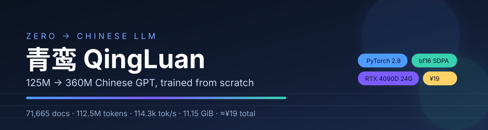
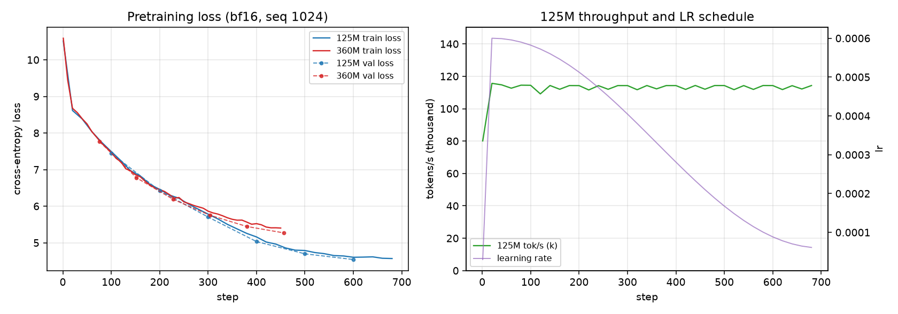
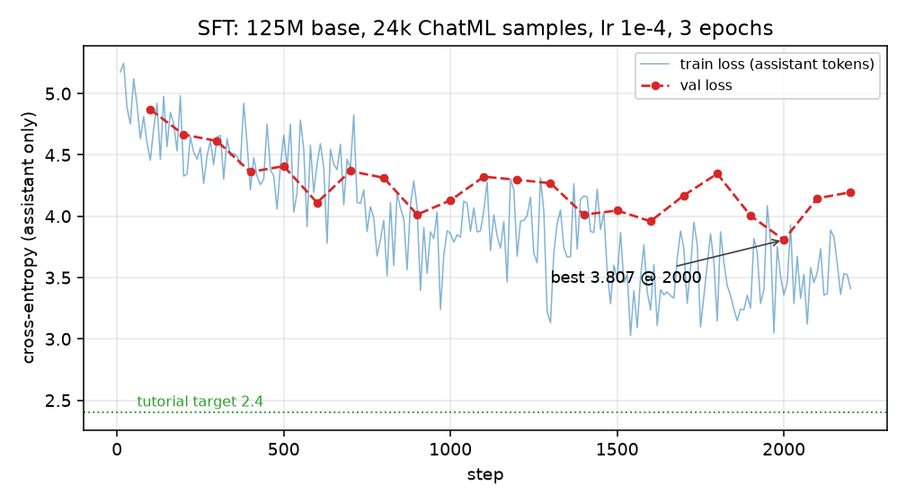

<div align="center">
  
</div>

<div align="center">

[](https://github.com/TanyaGaotiantian/zero-to-chinese-llm/stargazers)
[](LICENSE)
[](code/llm)
[](docs/en/02-pretraining.md)
[](docs/en/06-cost-and-pitfalls.md)

**From random weights to a chatty Chinese model with one 24 GB GPU, ¥19 (~$2.6), and 8 hours: corpus engineering → 125M pretraining → 360M pretraining → hard-verified crash recovery → SFT → a chat CLI with diary memory.**

**Every number below is measured, logged, and reproducible.** · [简体中文](README.md)

</div>

---

## 📌 What this is

An **honest, end-to-end reproducible** Chinese LLM training project. Not another "call the API" tutorial, not a 7B reproduction — it lays out **every step that actually bites** when you train a Chinese LLM from scratch:

| | Scale | Notes |
|---|---|---|
| Corpus | **71,665 docs / 112.50M tokens** | Chinese Wikipedia + Wikinews + Wikivoyage, with a hand-built clean/dedup/tokenize/pack pipeline |
| Models | **125.75M → 360.40M** | LLaMA-style (RMSNorm + RoPE + SwiGLU + tied embedding + SDPA), trained from random init |
| Hardware | **RTX 4090D 24 GB** | 125M runs at **114.3k tok/s**, peak **11.15 GiB**; 360M at 33.3k tok/s |
| Money | **≈¥19 (~$2.6)** | ¥11.3 of that was one incident (see [pitfalls](docs/en/06-cost-and-pitfalls.md)); effective cost ≈¥7.6 |

### Three proofs this is not a toy

1. **`kill -9` recovery verified.** Mid-run SIGKILL, resumed from `latest.pt`, then compared step-by-step against an uninterrupted baseline: **60/60 steps have identical batch fingerprints**, max |Δloss| = **0.0100** (tolerance 0.05). Data order, optimizer state and RNG state are restored exactly — not "it restarted, so it works".
2. **Throughput/VRAM are checkable.** 125M / seq 1024 / bf16 on a 4090D: 114.3k tok/s, 11.15 GiB. Raw `train.csv` files live in `results/`.
3. **The corpus funnel is auditable.** 485,894 raw documents → 283,923 passing quality gates (58.4%) → 283,492 after dedup → 71,665 after budget sampling; every rejection reason is in `results/funnel.json`.

> ⚠️ **What it cannot do:** a 125M model is not "smart". The value here is a **fully working, fully reproducible** training pipeline — corpus, resume semantics, VRAM/throughput ceilings, SFT and a memory system — not leaderboard scores.

---

## 📊 Results

### Corpus

| Split | Docs | Chars | Tokens |
|---|---:|---:|---:|
| train | 70,233 | 176,394,668 | **112,503,579** |
| val | 716 | 1,878,482 | 1,199,254 |
| test | 716 | 1,734,151 | 1,103,986 |
| **total** | **71,665** | 180,007,301 | **114,806,819** |

Tokenizer: sentencepiece **BPE 32,000**, `byte_fallback=true`, coverage 0.9995, measured **1.568 chars/token**.
Packing: flat `uint16` stream with EOS between documents → `train.bin` is 225 MB, `np.memmap`-ready.

### Pretraining

| Metric | 125M | 360M |
|---|---:|---:|
| Parameters | 125,753,088 | 360,403,968 |
| Layers / d_model / heads | 14 / 768 / 12 | 26 / 1024 / 16 |
| Effective batch | 491,520 tok/step | 491,520 tok/step |
| Steps / tokens | 699 / 343.6M (3.05 epochs) | 456 / 224.1M (2 epochs) |
| Throughput | **114.3k tok/s** | 33.3k tok/s |
| Peak VRAM (alloc / reserved) | **11.15 / 12.12 GiB** | 8.29 / 8.68 GiB (grad ckpt) |
| Final val_loss (ppl) | **4.541 (93.8)** | **5.271 (194.5)** |
| Wall clock | 50.6 min | 114.4 min |



### SFT + memory prototype

| Item | Value |
|---|---|
| Data | `YeungNLP/firefly-train-1.1M` streamed + filtered → **24,000** (23,500 train / 500 val) |
| Template | ChatML with `<|im_start|>`=32000 / `<|im_end|>`=32001 appended to the 32k spm vocab |
| Loss | **assistant tokens only** (user/system labels are -100) |
| Result | val_loss **3.81** (best, step 2000) / 4.20 (final); 3 epochs, 2205 steps |
| Battle scar | forgot the one-token label shift → the model learned to copy its input, val_loss collapsed to **0.0005**; fixed and kept as evidence |
| Memory | single SQLite file + FTS5 trigram index; diary summaries with `covered_until`; good/bad feedback attached to messages |

---

## ⚡ 5-minute quick start (no GPU)

Verify the model definition, the training loop and resume semantics on a laptop:

```bash
git clone https://github.com/TanyaGaotiantian/zero-to-chinese-llm && cd zero-to-chinese-llm
pip install torch numpy sentencepiece

# 1) parameter counts (expect 125.75M / 360.40M)
python code/llm/model.py

# 2) synthetic data + 20 steps on the tiny "smoke" config (CPU, ~1 min)
python code/llm/smoke_test.py --steps 20

# 3) kill -9 resume determinism check
python code/llm/smoke_test.py --resume-check
```

> `loss ≈ ln(32000) = 10.37` means the init is right; `batch fingerprints identical` means the resume semantics are right.

---

## 🚀 Full reproduction (~8 h, ~¥19)

### 0. One GPU box

| Item | Recommendation |
|---|---|
| Cloud | AutoDL or any pay-as-you-go GPU cloud; **4090 / 4090D 24 GB is the sweet spot** |
| Image | PyTorch **2.8.0** / Python **3.12** / CUDA **12.8** |
| Disk | 30 GB system + 50 GB data (**keep all data on the data disk**) |
| Billing | ~¥1.88/h; **GPU billing stops when you shut down**, data persists |

### 1. Fetch data (30 min, CPU-only mode is fine)

```bash
bash scripts/fetch_sources.sh
```

- Chinese Wikipedia: `wikimedia/wikipedia` `20231101.zh` parquet from the HF mirror (**the same derivative of the official dump**), measured 5.7 MB/s;
- Wikinews / Wikivoyage: official dumps (34 MB / 14 MB) through `wikiextractor`;
- Everything lands in one JSONL schema (`id/url/title/text`) so the rest of the pipeline has **zero branches**.

> Why not pull `zhwiki-latest-pages-articles.xml.bz2` (3.45 GB) directly? Measured: 9–80 KB/s per connection from a CN IDC → 12h+. 24-way parallel range requests only reach ~124 KB/s. See [pitfall #1](docs/en/06-cost-and-pitfalls.md).

### 2. Corpus engineering (8 min)

```bash
bash scripts/prep2.sh
```

`parquet→jsonl` → `wikiextractor` → clean → exact+MinHash dedup → 180M-char budget sample → 98/1/1 split → BPE 32k → `uint16` pack → stats.
Every stage is idempotent (skipped if its output exists), so **just re-run after an interruption**.

### 3. Smoke test + resume check (5 min)

```bash
bash scripts/stages.sh smoke     # 20 steps: throughput/VRAM sanity
bash scripts/stages.sh resume    # kill -9 resume comparison
```

### 4. Pretraining (125M: 50 min, 360M: 2 h)

```bash
bash scripts/stages.sh 125m
bash scripts/stages.sh 360m
```

### 5. SFT (40 min)

```bash
bash scripts/stages.sh sft
```

### 6. Chat CLI with memory

```bash
bash scripts/demo_memory.sh
# equivalent to:
export LLM_BASE_URL=http://127.0.0.1:8010/v1 LLM_MODEL=local-sft
python code/llm/serve_model.py --ckpt runs/sft/latest.pt \
       --tokenizer data/processed/tokenizer/zh_bpe.model --port 8010 &
python code/llm/memory_chat.py --session demo
```

Inside the CLI: `/diary` (compress history into a diary entry), `/recall <keyword>` (FTS5 search), `/feedback good|bad <note>`.

---

## 📖 Syllabus

> Every chapter stands alone, but the order matters: corpus first, verify resume before long runs.

| Ch | What you get | Key numbers | Status |
|---|---|---|---|
| [00 · Overview](docs/en/00-overview.md) | pipeline, why this order, acceptance, timeline | 4.5 h of compute | ✅ |
| [01 · Corpus](docs/en/01-corpus.md) | extract/clean/dedup/sample/tokenize/pack + funnel | 485,894 → **71,665** docs | ✅ |
| [02 · Pretraining](docs/en/02-pretraining.md) | architecture, hyperparameters, throughput/VRAM analysis | **114.3k tok/s / 11.15 GiB** | ✅ |
| [03 · Resume](docs/en/03-resume.md) | `kill -9` protocol, what a ckpt must hold, 5 mistakes | **60/60 fingerprints** | ✅ |
| [04 · SFT](docs/en/04-sft.md) | ChatML, vocab extension, assistant-only loss, one real bug | val **3.807** (best) | ✅ |
| [05 · Memory](docs/en/05-memory.md) | SQLite + FTS5 diary memory, extractive fallback, gate | 16 msg → 1 diary | ✅ |
| [06 · Cost & pitfalls](docs/en/06-cost-and-pitfalls.md) | itemised bill + **8 real pitfalls** (incl. a ¥11.3 idle) | ≈¥19 | ✅ |
| [07 · Checklist](docs/en/07-checklist.md) | 8-stage checklist with expected outputs | — | ✅ |

Chinese originals live in [docs/](docs/).



---

## 🗂 Layout

```text
zero-to-chinese-llm/
├─ README.md / README_en.md         # bilingual entry points
├─ docs/                            # Chinese tutorial (8 chapters)
│  ├─ 00-overview.md                #   roadmap and tradeoffs
│  ├─ 01-corpus.md                  #   funnel, dedup, tokenizer, packing
│  ├─ 02-pretraining.md             #   architecture, throughput/VRAM, compile
│  ├─ 03-resume.md                  #   crash-recovery verification methodology
│  ├─ 04-sft.md                     #   ChatML, assistant-only loss
│  ├─ 05-memory.md                  #   diary memory + FTS5 retrieval
│  ├─ 06-cost-and-pitfalls.md       #   the bill + 7 real pitfalls
│  └─ 07-checklist.md               #   reproduction checklist
├─ docs/en/                         # English versions
├─ code/llm/                        # 11 standalone scripts (no private deps)
├─ scripts/                         # one-shot scripts
├─ results/                         # real train.csv / stats.json / samples
└─ assets/                          # figures
```

| File | Purpose | Deps |
|---|---|---|
| `model.py` | 125M/360M GPT (RMSNorm+RoPE+SwiGLU+SDPA, tied emb) | torch |
| `train.py` | pretraining + **exact resume** (data order/RNG/optimizer) | torch, numpy |
| `parquet_to_jsonl.py` | HF parquet → wikiextractor-compatible JSONL | pyarrow |
| `prepare_corpus.py` | clean/dedup/split/tokenize/pack/stats (7 subcommands) | datasketch, sentencepiece |
| `sft.py` | ChatML SFT, assistant-only loss, vocab extension | torch, sentencepiece |
| `build_sft_data.py` | build 24k SFT set from HF streaming | datasets |
| `memory_chat.py` | chat CLI + diary compression + FTS5 + feedback | stdlib |
| `serve_model.py` | expose a local ckpt as an OpenAI-compatible endpoint | torch |
| `verify_resume.py` | compare two `train.csv` files | stdlib |
| `smoke_test.py` | 5-minute CPU end-to-end check | torch |

---

## 🧠 Design notes

<details>
<summary><b>1. Why checkpoints store data order + RNG</b></summary>

Saving only `model/optimizer/step` means the dataloader restarts from the beginning and the LR schedule jumps — the loss curve visibly breaks.
This project stores `epoch + pos + sha1(order)` in the checkpoint, rebuilds the permutation from `(seed, epoch)` and **asserts the sha1**, and also saves `torch_rng` / `cuda_rng`. That is why 60/60 batch fingerprints match in §3.
</details>

<details>
<summary><b>2. Why SDPA instead of FlashAttention</b></summary>

`F.scaled_dot_product_attention` uses the cuDNN/Flash backends in PyTorch 2.8 with **no custom kernel to compile**, so moving between 4090 / 5090 / sm_120 needs no rebuild. A 125M model is not attention-bound anyway.
</details>

<details>
<summary><b>3. Why cap MinHash shingles</b></summary>

280k docs × ~1400 chars ≈ 300M 5-grams; per-shingle `update` takes over an hour in pure Python. Deterministically sampling **512 shingles per doc** plus `update_batch` cuts dedup to ~2 minutes with negligible quality loss (MinHash is an estimator anyway).
</details>

<details>
<summary><b>4. Why SFT loss is assistant-only</b></summary>

If user/system tokens contribute to the loss, the model spends capacity re-stating the question: val_loss looks better while generation gets worse. Here every `<|im_start|>role\n` prefix, special token and pad is `label=-100`.
</details>

<details>
<summary><b>5. Why FTS5 trigram instead of a vector DB</b></summary>

Diary entries are few (dozens to thousands). Chinese substring search works out of the box with `tokenize='trigram'`: zero dependencies, zero embedding cost, explainable results. Swap in a vector store later without changing the interface.
</details>

---

## 🧰 Three snippets you can steal right now

You do not need to run the whole project for these to pay off:

**① A checkpoint that actually resumes**

```python
ckpt = {"model": model.state_dict(), "optim": optim.state_dict(),
        "step": step, "tokens": tokens_seen, "config": asdict(cfg),
        "data": {"epoch": ds.epoch, "pos": ds.pos, "n": ds.n,
                 "order_sha1": hashlib.sha1(ds.order.tobytes()).hexdigest()},
        "torch_rng": torch.get_rng_state(), "cuda_rng": torch.cuda.get_rng_state_all()}
```

**② Make MinHash 30x faster**

```python
sh = deterministic_sample(5_grams(doc.text), 512)   # cap shingles per document
m.update_batch([s.encode() for s in sh])            # vectorised path, no python loop
```

**③ Never store raw model output as a fact in your memory system**

```python
digest = extractive_digest(recent_turns)            # facts first, never invented
gen = llm_summarise(recent_turns)                   # optional narrative
summary = digest + ("\nmodel note: " + gen if passes_quality_gate(gen) else "")
```

---

## 🕳 Eight real pitfalls (all paid for)

| # | Pitfall | Cost | Fix |
|---|---|---|---|
| 1 | Wikimedia dumps throttled to 9–80 KB/s from a CN IDC | nearly 12 h | use the HF parquet path (5.7 MB/s) + schema conversion |
| 2 | "GPU-less mode" is **0.5 vCPU / 2 GB** | confusion | CPU mode for downloads only |
| 3 | GPU is taken by someone else after shutdown | 20 min | clone the instance to another host |
| 4 | Cloning without ticking the data disk | re-download 1.5 GB | tick both disks |
| 5 | Interrupted tool call, never checked the background job | **6 h idle = ¥11.3** | always `pgrep`/`tail`; use an auto-chaining script |
| 6 | `wikiextractor 3.1` renamed shards from `wiki_00` to `AA` | clean read 0 docs | glob the directory, not the filename |
| 7 | MinHash too slow | 1 h+ | shingle cap + `update_batch` |

Full post-mortem: [docs/en/06-cost-and-pitfalls.md](docs/en/06-cost-and-pitfalls.md).

---

## 💰 The bill

| Stage | Wall clock | Cost |
|---|---|---|
| Fetch + corpus (incl. 1.2 h CPU-only) | ~1.4 h | ¥0.37 |
| Smoke + resume check | 5 min | ¥0.16 |
| 125M pretraining | 50.6 min | ¥1.59 |
| 360M pretraining | 114.4 min | ¥3.58 |
| SFT | ~40 min | ¥1.25 |
| **Incident: idle instance** | 6 h | **¥11.3** |
| **Total** | | **≈¥18.4 (~$2.6)** |

> Without the incident the whole project costs **≈¥7.1**. That is the honest price of "pay-as-you-go + watch your background jobs".

---

## 🗺 Roadmap

- [x] Corpus engineering (71,665 docs / 112.5M tokens / 32k BPE)
- [x] 125M from-scratch pretraining with measured throughput/VRAM
- [x] hard `kill -9` resume verification
- [x] 360M pretraining (grad ckpt + compile)
- [x] 24k ChatML SFT
- [x] SQLite + FTS5 diary memory CLI
- [ ] 4K context + RoPE scaling comparison
- [ ] Chinese eval subset (CEval/CMRC sampling)
- [ ] hybrid diary + vector retrieval

---

## 🙏 Credits

- Documentation style inspired by [datawhalechina/zero-to-sglang](https://github.com/datawhalechina/zero-to-sglang) (course layout) and [zgcagi/ZGCM-1](https://github.com/zgcagi/ZGCM-1) (model-card layout).
- Corpus: [Wikimedia](https://dumps.wikimedia.org/) (CC BY-SA) and [wikimedia/wikipedia](https://huggingface.co/datasets/wikimedia/wikipedia); SFT: [YeungNLP/firefly-train-1.1M](https://huggingface.co/datasets/YeungNLP/firefly-train-1.1M).
- Tooling: `sentencepiece`, `datasketch`, `wikiextractor`.

## 📄 License

Code: [Apache-2.0](LICENSE). Corpora keep their upstream licenses (Wikipedia is CC BY-SA 4.0).

## ⭐ If this saved you a few days

A star is enough — it tells me that writing down the pitfalls is worth the effort.

<div align="center">
  <sub>Built with a 24 GB GPU, ¥19, and a strong preference for reproducible numbers.</sub>
</div>
