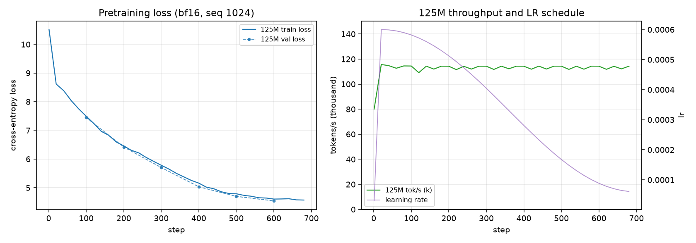

# 02 · 预训练：125M 跑 114.3k tok/s，显存 11.15 GiB

> 这一章讲清楚：模型长什么样、超参怎么定、**为什么 4090D 比 5070 Ti 快 6 倍**、以及 `torch.compile` 到底值不值。

## 1. 模型结构

LLaMA 式 decoder-only，**没有一行自定义 CUDA kernel**：

| 组件 | 选择 | 为什么 |
|---|---|---|
| Norm | RMSNorm（pre-norm） | 比 LayerNorm 少一次均值、更省带宽 |
| 位置编码 | RoPE（θ=10000，interleaved） | 无参数、外推友好 |
| FFN | SwiGLU（hidden=8/3·d，取整到 128 的倍数 → 2112 / 2736） | 同参数量下优于 GELU-MLP |
| 词嵌入 | **tied**（`lm_head.weight = tok_emb.weight`） | 32k×768 = 24.6M，占 125M 的 20%，不 tie 太亏 |
| 注意力 | `F.scaled_dot_product_attention` | PyTorch 2.8 会走 cuDNN/Flash 后端，免编译、换卡不用重装 |
| Dropout | 0 | 数据量远大于参数量，不需要 |

参数量（`python code/llm/model.py` 实测）：

| 配置 | 层 | d_model | heads | ffn | seq | embedding | blocks | **total** |
|---|---:|---:|---:|---:|---:|---:|---:|---:|
| 125m | 14 | 768 | 12 | 2112 | 1024 | 24,576,000 | 101,176,320 | **125,753,088** |
| 360m | 26 | 1024 | 16 | 2736 | 1024 | 32,768,000 | 327,634,944 | **360,403,968** |

> 与常见口径的 125.85M / 360.76M 差 0.08% / 0.10%，来自 ffn 取整与 norm 细节。要严格对齐就微调 `ffn_hidden`（+16 → 125M 加 0.52M）。

## 2. 超参

| 项 | 125M | 360M | 依据 |
|---|---:|---:|---|
| seq_len | 1024 | 1024 | 数据是维基段落，1K 足够；再长显存翻倍 |
| micro-batch | 16 | 8 | 让单步显存贴着 12 GiB / 9 GiB |
| grad-accum | 30 | 60 | 有效 batch 都是 **491,520 tokens**（≈0.44% 的 112M） |
| max-steps | 699 | 456 | 3.05 epoch / 2 epoch |
| lr | 6e-4 | 3e-4 | 小模型可以更激进；360M 加深后降一半 |
| warmup | 20 | 24 | ≈3% steps |
| schedule | cosine → 10% | 同 | 末端保留 10% 学习率，避免后期完全冻住 |
| weight decay | 0.1（只对 ≥2 维参数） | 同 | norm/bias 不衰减 |
| grad clip | 1.0 | 1.0 | 观察 `gn` 稳定在 0.3–0.7 |
| 精度 | bf16 autocast | bf16 + **grad checkpoint** | 4090 支持 bf16，不需要 loss scale |
| 优化器 | AdamW(0.9, 0.95) | 同 | 小模型 β2=0.95 更稳 |

## 3. 跑起来

```bash
# 20 步冒烟（先确认吞吐/显存，2 分钟）
bash scripts/stages.sh smoke

# 正式训练
bash scripts/stages.sh 125m     # 50 min
bash scripts/stages.sh 360m     # 2 h
```

`stages.sh` 里的关键参数（可直接复制）：

```bash
python train.py --config 125m --data-dir data/processed/bin --run-dir runs/125m \
  --micro-batch 16 --grad-accum 30 --max-steps 699 --warmup 20 \
  --lr 6e-4 --min-lr-ratio 0.1 --weight-decay 0.1 \
  --eval-interval 100 --eval-batches 20 --save-interval 50 --log-interval 20 \
  --time-budget-min 170 --compile --tokenizer data/processed/tokenizer/zh_bpe.model \
  --sample-prompt "中国的首都是"
```

## 4. 实测结果

### 125M（699 步 / 343.6M tokens / 50.6 min）

| step | loss | lr | tok/s |
|---:|---:|---:|---:|
| 1 | 10.5145 | 3.0e-05 | 80.1k |
| 20 | 8.6147 | 6.0e-04 | 115.7k |
| 100 | 7.4460 *(val)* | 5.8e-04 | 114.5k |
| 300 | 5.7029 *(val)* | 3.3e-04 | 114.3k |
| 500 | 4.6975 *(val)* | 1.7e-04 | 114.3k |
| 600 | 4.5412 *(val)* | 9.1e-05 | 111.8k |
| **699** | **4.55（train）** | 6.6e-05 | 112.2k |

- 起点 `10.5145 ≈ ln(32000)=10.373`，说明初始化正确（略高是因为第一个 micro-batch 的随机波动 + 位置编码未训）；
- 峰值显存 **11.15 GiB allocated / 12.12 GiB reserved**；
- ppl 从 1713（step100）降到 **93.8**（step600）。



### 360M（456 步 / 224.1M tokens）

| step | loss | tok/s |
|---:|---:|---:|
| 1 | 10.59 | 7.6k（compile 中） |
| 80 | 7.72 | 28.0k |
| 200 | 6.46 | 32.4k |
| 320 | 5.78 | 33.2k |
| 456 | ~5.4 | ~33k |

360M 的吞吐只有 125M 的 **29%**（33.3k vs 114.3k），但参数量只有 2.87 倍——因为
`grad checkpoint` 把激活重算了一遍，另外 26 层的 kernel launch 开销更碎。

## 5. 为什么 4090D 能跑到 114k tok/s

这是本章最值得记住的一段。结论先给：**小模型的瓶颈不是显存带宽，是"每 step 的计算能不能把 SM 喂满"。**

| 因素 | 影响 |
|---|---|
| 4090D vs 5070 Ti 的 FP16 张量算力 | ≈2.2 倍（4090D ~165 TFLOPS dense vs 5070 Ti ~70） |
| 有效 batch 491k tokens / step | 每步矩阵乘的 M 维很大，**kernel 效率接近峰值**，不是 latency-bound |
| `torch.compile` | 融合 RMSNorm/SwiGLU 的逐元素算子，减少 20–30% 的 kernel 时间（首步编译 ~40 s，之后白赚） |
| tied embedding | 反向时省一次 24.6M×768 的大矩阵梯度 |
| `uint16` 数据 + memmap | 数据加载完全不占 CPU（随机索引 4 MB 级） |

反过来说：**如果你的 batch 很小（比如 micro-batch 1），4090D 也跑不出这个数**——这就是为什么有效 batch 要开到 0.5M tokens。

### torch.compile 到底值不值

| | 关闭 | 开启 |
|---|---:|---:|
| 首步耗时 | ~6 s | ~40 s（编译） |
| 稳定吞吐 | ~92k tok/s | **114k tok/s** |
| 结论 | | **699 步的长跑，编译成本 40 s 换回 ~20% 吞吐，值** |

> 但注意：`torch.compile` 在 **CPU 上会自动跳过**（`train.py` 里判断了 `device=="cuda"`），所以冒烟测试在本机也能跑。

## 6. 怎么扩到更大

| 想扩到 | 改什么 | 注意 |
|---|---|---|
| 1B | `n_layer=24, n_embd=2048, n_head=16, ffn=5504` | 必须 grad ckpt + 8-bit Adam 或 ZeRO，单卡 24 GB 不够 |
| 更长上下文 4K | `seq_len=4096` + RoPE θ 调到 5e4 | 显存 ×4，micro-batch 降到 4 |
| 更快 | micro-batch 提到 32（125M 显存够） | 吞吐可能再涨 5–10%，但注意有效 batch 别太大 |
| 更稳 | `--min-lr-ratio 0.05`、`--grad-clip 0.5` | 后期 loss 抖动会小一些 |

## 7. 本章验收

```bash
tail -3 runs/125m/train.csv
# 期望：699 行，最后一行 tok_per_s 在 110k 量级

grep -E "\[mem\]|\[done\]" logs/125m.log
# [mem] peak allocated 11.15 GiB, reserved 12.12 GiB
# [done] steps=699 tokens=343572480 wall=50.6 min
```

---

上一章：[01 · 语料工程](01-corpus.md)　下一章：[03 · 断点续训的硬验证](03-resume.md)
