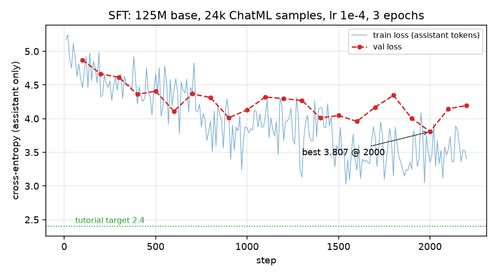

# 04 · SFT: turning a base model into an answering model

> One question decides this whole chapter: **which tokens carry the loss?**

## 1. Data: 24,000 pairs

```bash
python code/llm/build_sft_data.py --source firefly --n 24000 --out data/sft
```

Streamed from `YeungNLP/firefly-train-1.1M`, filtered by: 10–2000 chars of user text,
10–4000 chars of answer, `len(answer) ≥ 0.2 × len(user)`, sha1 dedup, and dropping
"as an AI language model…" templates. Result: **23,500 train / 500 val**.

## 2. ChatML and vocab extension

```text
<|im_start|>system
你是一个简洁、诚实的中文助手。<|im_end|>
<|im_start|>user
中国的首都是哪里？<|im_end|>
<|im_start|>assistant
北京。<|im_end|>
```

`<|im_start|>` = 32000, `<|im_end|>` = 32001, appended above the 32k spm vocab.
When loading the base weights only the first 32k rows are copied; the two new rows are random.

## 3. Assistant-only loss

```python
labels += (cids if role == "assistant" else [-100] * len(cids))
labels.append(IM_END if role == "assistant" else -100)
```

Everything else — role prefixes, special tokens, padding — is `-100`.

| Approach | val_loss | Generation |
|---|---:|---|
| all tokens | lower (fake) | worse: the model restates the question |
| **assistant only** | higher (real) | better: all gradients go into answering |

**The bug this chapter exists to prevent.** `GPT.forward` computes
`cross_entropy(logits, targets)` *without* shifting, so `targets[t]` must be the token
**after** `x[t]`. Passing unshifted labels teaches a copy map — nearly free with tied
embeddings — and the loss collapses to ~5e-4 while generation stays broken. The dataset
now shifts explicitly:

```python
pairs = [(ids[:-1], labels[1:]) for ids, labels in encoded]
```

This is pitfall #8 in [06](06-cost-and-pitfalls.md); the failing run is kept as
`logs/sft_buggy.log` (val_loss 0.0005) next to the fixed runs.

## 4. Hyperparameters

| Item | Value |
|---|---|
| init | `runs/125m/latest.pt` |
| batch × accum | 8 × 4 (32 samples/step) |
| lr | 1e-4 cosine → 10% (1e-5 converges much slower: 4.42 vs 3.81) |
| warmup | 50 |
| epochs | 3 |

## 5. Results



| Run | val_loss | Note |
|---|---:|---|
| buggy (no shift) | **0.0005** | degenerate copy solution — loss looks perfect, generation is broken |
| lr 1e-5, 2 epochs | 4.416 | converges too slowly |
| **lr 1e-4, 3 epochs** | **3.8069** (best, step 2000) / 4.1954 (final) | the reported run |

### Why not ~2.4?

Because the base is **far from compute-optimal**: 125M parameters eating 112.5M tokens is
~1.9 tokens/param, while compute-optimal recipes use ~20. The base's own wiki val_loss is 4.54;
SFT can only align the output distribution, not recover pretraining capacity that was never paid for.

Reaching a 2.4-range SFT loss would need either 10–20× more pretraining tokens (¥40–80 of compute)
or a larger base model. **That is the real lesson of this chapter: SFT does not make a model
smarter, it makes it answer in your format using what it already knows.**

## 6. Serving the model

```bash
python code/llm/serve_model.py --ckpt runs/sft/latest.pt \
       --tokenizer data/processed/tokenizer/zh_bpe.model --port 8010
```

It builds ChatML, generates, cuts at the first `<|im_end|>` and answers in OpenAI format.
No KV cache (a 125M model does 200 tokens in ~1–2 s), which is fine for prototypes.

## 7. Verify

```bash
grep "\[eval\]" logs/sft.log | tail -3
python -c "import json;rows=[json.loads(l) for l in open('data/sft/train.jsonl')];print(len(rows))"
```

---

Previous: [03 · Resume](03-resume.md) · Next: [05 · Memory](05-memory.md)
